# Tarefas na Nuvem – Projeto Integrador de Computação em Nuvem

Aplicação web de lista de tarefas implantada na AWS, com infraestrutura como código (Terraform), pipeline CI/CD (GitHub Actions), gerenciamento de segredos e observabilidade (Prometheus, Loki e Grafana).

- **Aplicação no ar:** http://100.31.11.80
- **Grafana:** http://100.31.11.80:3000
- **Disciplina:** Computação em Nuvem – UFRPE
- **Repositório:** https://github.com/victor7miguel7/projeto-nuvem-2VA

## LINK VÍDEOS DO FUNCIONAMENTO DA APLICAÇÃO E DE PIPELINE 
- **VÍDEO DA APLICAÇÃO RODANDO:** https://youtu.be/QfuI51g0jFs
- **VÍDEO ALTERAÇÃO NO FRONT SENDO APROVADA PELA PIPELINE:** https://youtu.be/l_UNdKzQEF8

## Integrantes e divisão de tarefas

| Integrante | Responsabilidade principal |
|---|---|
| Victor | Aplicação (backend, frontend) e testes |
| Victor | Terraform e serviços AWS |
| Victor | Pipeline CI/CD e gerenciamento de segredos |
| Victor | Observabilidade e documentação |

Todos os integrantes participaram do desenvolvimento e conhecem a arquitetura completa. O histórico de commits do repositório registra a contribuição de cada um.

## Problema e funcionalidades

Pessoas e equipes pequenas precisam organizar tarefas do dia a dia de forma simples e acessível de qualquer lugar. A aplicação permite:

- Criar tarefas com título, **prioridade** (alta, média ou baixa) e **prazo**, com validação de título vazio
- Editar título, prioridade e prazo de uma tarefa
- Marcar tarefas como concluídas e reabri-las
- Remover tarefas, individualmente ou todas as concluídas de uma vez
- **Filtrar** por situação (todas, pendentes, concluídas) e **buscar** por texto
- Ordenação automática: pendentes primeiro, por prioridade e depois pelo prazo mais próximo
- Destaque das tarefas **atrasadas** e painel de progresso do dia
- Consultar a saúde (`/health`) e as métricas (`/metrics`) da aplicação

Os dados ficam persistidos em um banco SQLite gravado em um volume no disco (EBS) da EC2, e sobrevivem à reinicialização dos containers. Bancos criados em versões anteriores são migrados automaticamente na inicialização.

### API

| Método e rota | Função |
|---|---|
| `GET /api/tarefas?status=&busca=` | Lista tarefas, com filtro por situação (`pendentes` ou `concluidas`) e busca por texto |
| `POST /api/tarefas` | Cria tarefa (`titulo`, `prioridade`, `prazo`) |
| `PATCH /api/tarefas/{id}` | Atualiza título, situação, prioridade ou prazo |
| `DELETE /api/tarefas/{id}` | Remove uma tarefa |
| `DELETE /api/tarefas/concluidas` | Remove todas as tarefas concluídas |
| `GET /api/resumo` | Totais (todas, pendentes, concluídas e atrasadas) |
| `GET /health` | Verificação de disponibilidade |
| `GET /metrics` | Métricas no formato Prometheus |

## Arquitetura

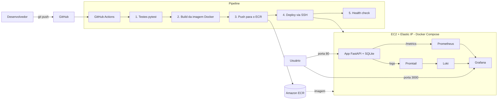

**Componentes**

| Componente | Função |
|---|---|
| FastAPI | Backend (API REST) e servidor do frontend estático |
| HTML/JavaScript | Interface do usuário (página única, sem dependências de build) |
| SQLite (volume `./data`) | Persistência dos dados |
| Docker Compose | Executa app, Prometheus, Loki, Promtail e Grafana na mesma EC2 |
| Prometheus | Coleta de métricas (`/metrics`) |
| Loki + Promtail | Coleta e armazenamento de logs dos containers |
| Grafana | Dashboards de métricas e logs |

## Tecnologias e justificativas

| Tecnologia | Justificativa |
|---|---|
| **Amazon EC2** | Controle simples do ambiente de execução; uma instância `t3.small` comporta aplicação e observabilidade com baixo custo |
| **Elastic IP** | IP fixo, necessário para o deploy automatizado e para acesso estável |
| **Amazon ECR** | Registro de imagens Docker integrado à AWS; cada deploy usa uma imagem versionada pelo hash do commit |
| **Terraform** | Infraestrutura reproduzível e versionada no Git |
| **GitHub Actions** | Pipeline integrado ao repositório, sem servidor adicional |
| **GitHub Secrets** | Armazena credenciais com mascaramento nos logs. O enunciado trata o Infisical como opcional ("poderão ser utilizadas"), e para o escopo do projeto os Secrets atendem ao requisito sem exigir um serviço extra |
| **FastAPI** | Leve, rápido de testar e com instrumentação de métricas simples |
| **SQLite** | Suficiente para o escopo; evita um banco gerenciado (RDS), que seria mais custoso para o ambiente de aprendizagem |
| **Prometheus, Loki, Grafana** | Pilha de observabilidade citada no enunciado, com métricas, logs e visualização integrados |

## Estrutura do repositório

```
.
├── app/                    # aplicação (FastAPI), testes e Dockerfile
│   ├── main.py
│   ├── static/index.html
│   ├── tests/test_api.py
│   ├── requirements.txt
│   └── Dockerfile
├── infra/main.tf           # Terraform (EC2, ECR, Security Group, chave SSH, Elastic IP)
├── monitoring/             # Prometheus, Promtail, datasources e dashboard do Grafana
├── docker-compose.yml
├── .github/workflows/deploy.yml
├── docs/                   # evidências (prints)
├── PROPOSTA.md
└── README.md
```

## Como executar localmente

Pré-requisitos: Python 3.12 e Docker.

```bash
# Testes
cd app
pip install -r requirements.txt
python -m pytest

# Aplicação completa com observabilidade
cd ..
docker build -t tarefas app
IMAGE=tarefas GRAFANA_PASSWORD=admin docker compose up
```

- Aplicação: http://localhost
- Prometheus: http://localhost:9090
- Grafana: http://localhost:3000 (usuário `admin`)

## Como implantar

Pré-requisitos: conta no AWS Academy (Learner Lab), Terraform e um par de chaves SSH.

**1. Provisionar a infraestrutura (uma vez)**

```bash
ssh-keygen -t ed25519 -f ~/.ssh/tarefas
# Iniciar o lab e exportar as credenciais temporárias (AWS Details):
export AWS_ACCESS_KEY_ID=...
export AWS_SECRET_ACCESS_KEY=...
export AWS_SESSION_TOKEN=...
cd infra
terraform init
terraform apply -var="public_key=$(cat ~/.ssh/tarefas.pub)"
```

O Terraform exibe `ip_publico` e `ecr_url`. O `user_data` da EC2 instala Docker e AWS CLI e aplica a configuração do Docker necessária para o Promtail (ver [Observabilidade](#observabilidade)).

**2. Cadastrar os secrets no GitHub** (Settings → Secrets and variables → Actions)

| Secret | Conteúdo |
|---|---|
| `AWS_ACCESS_KEY_ID` | Credencial temporária do Learner Lab |
| `AWS_SECRET_ACCESS_KEY` | Credencial temporária do Learner Lab |
| `AWS_SESSION_TOKEN` | Token temporário do Learner Lab |
| `EC2_HOST` | `ip_publico` exibido pelo Terraform |
| `EC2_SSH_KEY` | Chave privada SSH |
| `GRAFANA_PASSWORD` | Senha do administrador do Grafana |

> As credenciais do Learner Lab mudam a cada início de sessão e precisam ser atualizadas nos secrets antes de um novo deploy.

> O botão **Reset** do Learner Lab apaga todos os recursos da conta. Nesse caso, basta rodar o `terraform apply` novamente e atualizar o secret `EC2_HOST` com o novo IP.

**3. Implantar:** fazer push na branch `main`. O pipeline executa automaticamente.

**4. Dashboard do Grafana:** em Dashboards → New → Import, enviar `monitoring/dashboard-tarefas.json` e selecionar as fontes Prometheus e Loki.

## Como remover os recursos

Com o Learner Lab ligado:

```bash
cd infra
terraform destroy -var="public_key=$(cat ~/.ssh/tarefas.pub)"
```

## Pipeline CI/CD

O workflow `.github/workflows/deploy.yml` roda a cada push na `main`:

| Etapa | Descrição |
|---|---|
| 1. Verificação e testes | Instala dependências e executa `pytest` |
| 2. Build | Constrói a imagem Docker da aplicação |
| 3. Disponibilização do artefato | Envia a imagem ao Amazon ECR, com tag igual ao hash do commit |
| 4. Deploy | Aguarda a EC2 ficar pronta, envia o `docker-compose.yml` e a configuração de monitoramento e executa `docker compose up -d` |
| 5. Verificação pós-deploy | `curl --fail` em `/health`, com novas tentativas; falha o pipeline se a aplicação não responder |

## Testes e qualidade

Testes de API com `pytest` e `TestClient` do FastAPI, em `app/tests/test_api.py`, usando um banco SQLite temporário a cada execução:

- `/health` responde corretamente
- Criação e listagem de tarefas, com prioridade padrão e com prioridade e prazo informados
- Rejeição de título vazio (HTTP 400) e de prioridade inválida (HTTP 422)
- Conclusão e reabertura de tarefas
- Edição de título, prioridade e prazo, incluindo remoção do prazo e rejeição de título vazio
- Atualização de tarefa inexistente (HTTP 404)
- Filtro por situação, busca por texto e ordenação por prioridade
- Resumo de totais e tarefas atrasadas
- Remoção de tarefa (e 404 ao remover novamente) e limpeza das concluídas
- Exposição das métricas HTTP e de negócio em `/metrics`

**Influência dos testes no deploy:** o job `deploy` declara `needs: test`. Se qualquer teste falhar, o job `deploy` é ignorado e a aplicação em produção continua na versão anterior. Isso foi demonstrado com um teste quebrado de propósito (ver [Evidências](#evidências)).

## Segurança e gerenciamento de segredos

- Credenciais da AWS, chave SSH e senha do Grafana ficam em **GitHub Secrets**, nunca no código-fonte.
- O GitHub mascara os valores dos secrets nos logs do pipeline.
- `.env`, `*.tfstate` e `.terraform/` estão no `.gitignore`.
- O arquivo `.env` com a senha do Grafana é gerado durante o pipeline e enviado à EC2 por SCP (conexão criptografada); não é versionado.
- A EC2 usa o perfil de instância `LabInstanceProfile` (permissão de leitura no ECR), sem chaves de acesso gravadas na máquina.
- O acesso SSH usa autenticação por chave.
- A interface monta o conteúdo das tarefas como texto (não como HTML), evitando injeção de scripts, e a API valida os dados de entrada (tamanho do título, prioridade e formato de data).
- As consultas ao banco usam parâmetros, evitando injeção de SQL.

## Observabilidade

| Pilar | Implementação |
|---|---|
| **Métricas** | A aplicação expõe `/metrics` (prometheus-fastapi-instrumentator). O Prometheus coleta a cada 10 s: requisições, status HTTP, tempo de resposta e disponibilidade (`up`). Há também métricas de negócio: `tarefas_criadas_total` e `tarefas_concluidas_total` |
| **Logs** | A aplicação registra operações (criação, atualização, remoção) e erros. O Promtail coleta os logs dos containers e os envia ao Loki |
| **Visualização** | Dashboard "Tarefas - Observabilidade" no Grafana, com painéis de métricas e logs (`monitoring/dashboard-tarefas.json`) |

**Observação técnica:** o Docker instalado na EC2 (série 29) recusa clientes com API antiga, e o Promtail 2.9.4 falhava com o erro `client version 1.42 is too old`. A correção é definir `DOCKER_MIN_API_VERSION=1.24` no serviço do Docker (drop-in do systemd), e isso é feito automaticamente pelo `user_data` do Terraform na criação da EC2.

## Evidências

Todos os prints estão na pasta [`docs/`](docs/).

### Infraestrutura (Terraform e AWS)

Saída do `terraform apply`, com os 5 recursos criados:

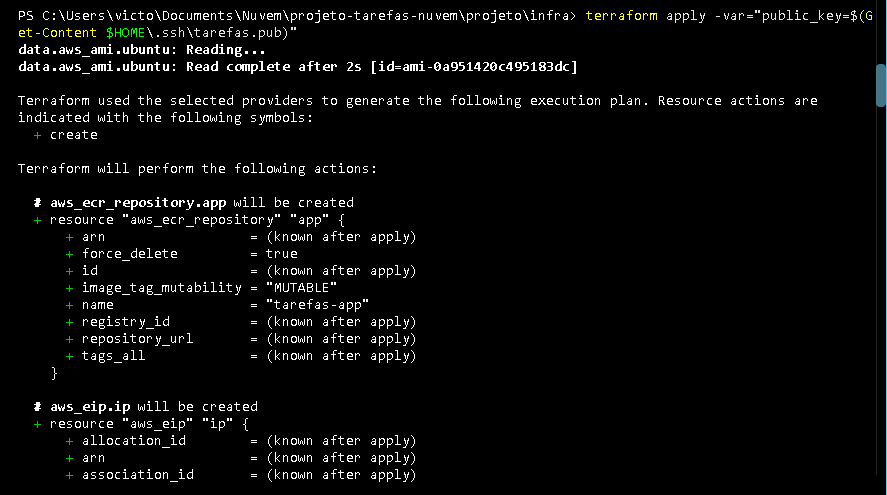
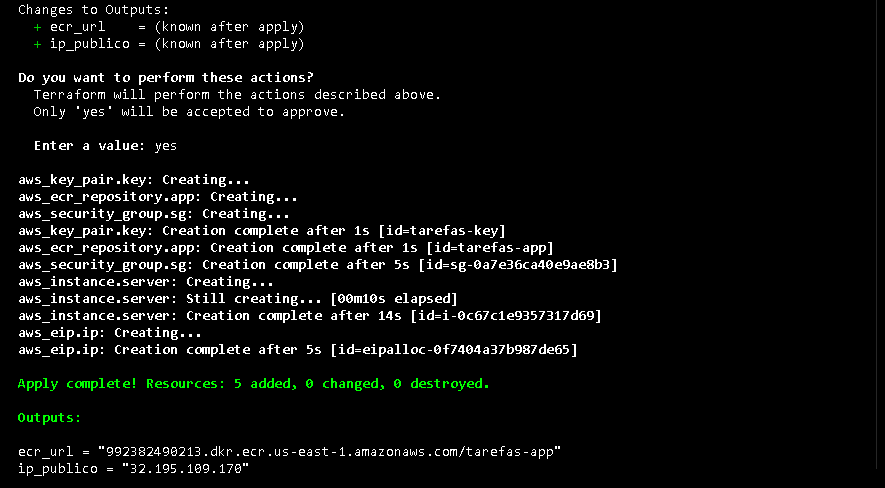

### Pipeline CI/CD

Execução completa e bem-sucedida (testes, build, push no ECR, deploy e health check):

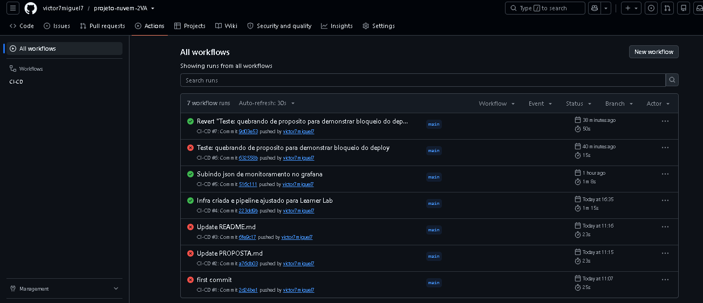

### Testes bloqueiam o deploy

Com um teste quebrado de propósito, o job `test` falha e o job `deploy` é ignorado:

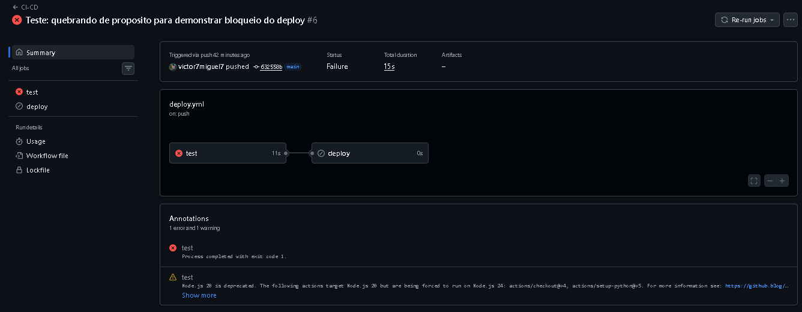
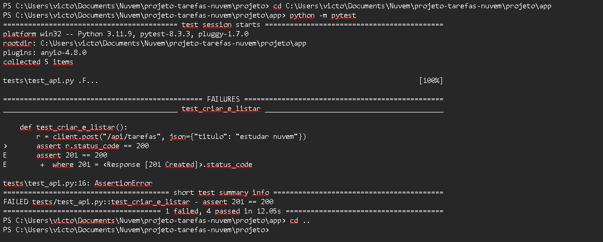

Histórico de commits: commit com o teste quebrado (❌), seguido do revert (✅):


### Segurança

Secrets cadastrados no repositório (valores ocultos pelo GitHub):

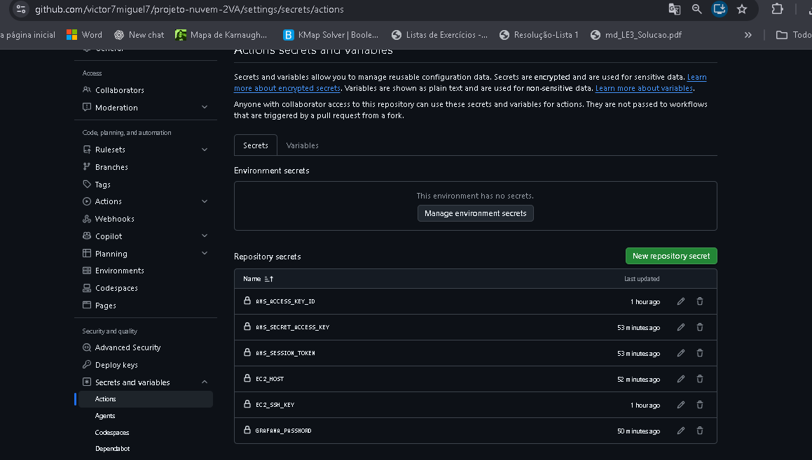

### Aplicação em execução

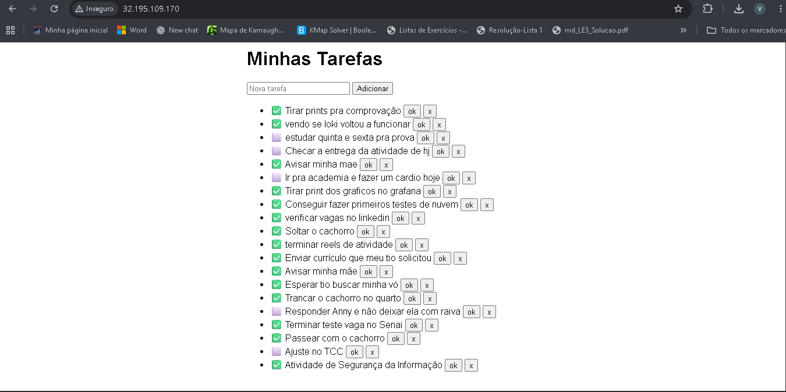

### Observabilidade

Prometheus coletando a aplicação (`up{job="app"} = 1`):

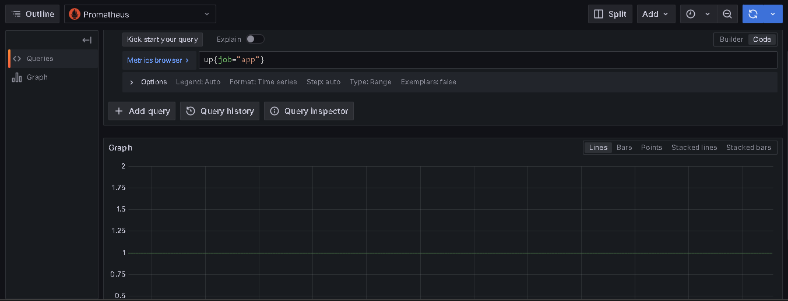

Dashboard do Grafana com métricas:


Painel de logs da aplicação (Loki), incluindo logs de erro:

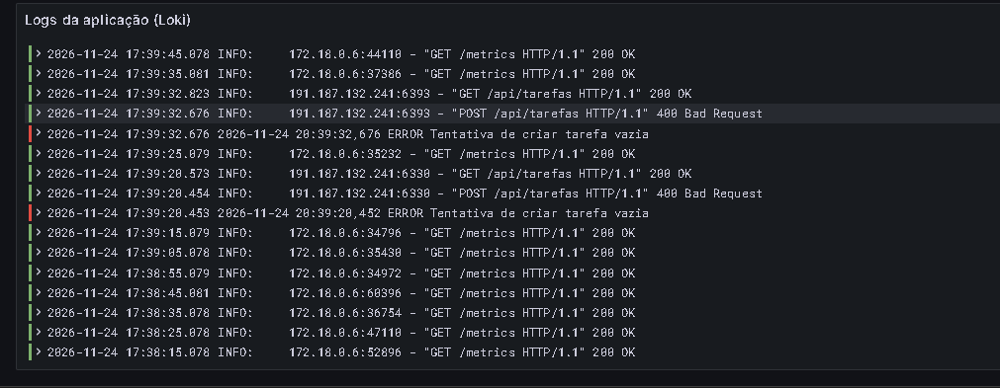
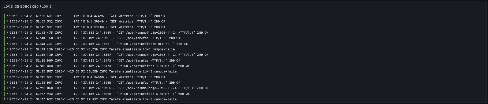
## Limitações conhecidas

- A aplicação não tem autenticação: qualquer pessoa com o endereço pode ver e alterar as tarefas. Em um cenário real, cada usuário teria login e suas próprias tarefas.
- A porta SSH (22) está aberta para qualquer IP, por simplicidade; em produção seria restrita a IPs conhecidos ou substituída pelo AWS Systems Manager.
- Grafana e aplicação usam HTTP, sem HTTPS.
- O SQLite não suporta múltiplas instâncias da aplicação, e a EC2 única é um ponto único de falha.
- O deploy por SSH foi escolhido pela simplicidade; ECS ou Kubernetes ofereceriam mais escalabilidade.
- As credenciais do Learner Lab expiram a cada sessão e precisam ser renovadas nos secrets.
